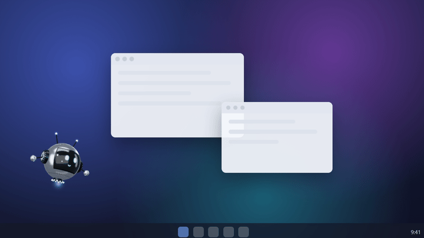
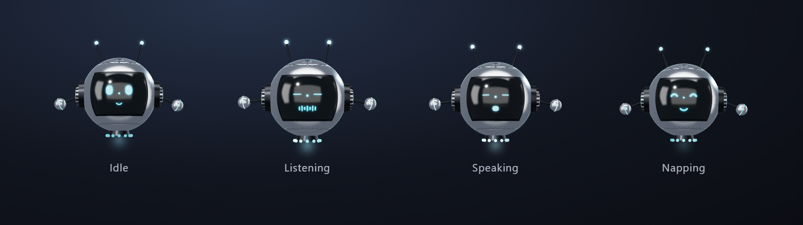
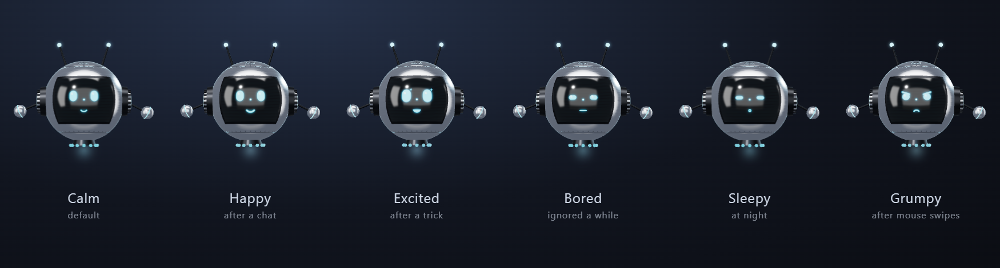
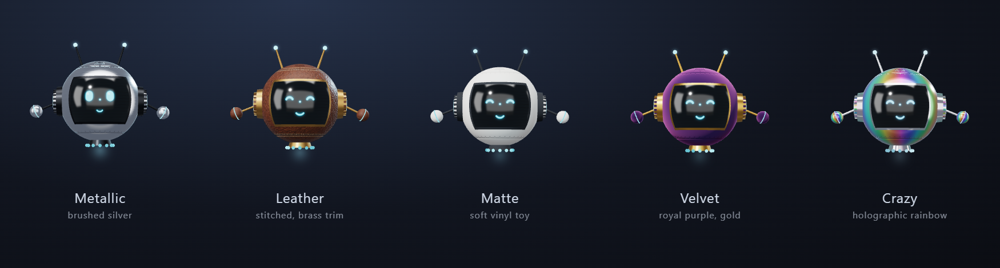

# Orbit AI 

> [!WARNING]
> **Beta (v0.1.0-beta).** Orbit is still in beta: things may change and you may run into bugs. When the final
> version is released, this page will be updated here. Found a problem? Please
> [open an issue](https://github.com/Quantumdrift21/orbit-ai/issues).

**A tiny 3D robot that lives on your Windows desktop and talks with you.**



Orbit floats over your other windows, flies around on its own, dodges your mouse and takes naps.
Click it, ask anything out loud, and it answers with a real voice using Google's Gemini Live API.
It speaks **99 languages** (including English and Tamil), opens any app on your PC by voice, and does flying stunts.

> Free and open source (MIT). You bring your own free Gemini API key.

## Features



- **Voice chat**: click the robot (or press **Ctrl+Space**) and speak; it sends when you pause (or click again). Orbit answers out loud,
  with live captions.
- **99 languages**: every language the Gemini Live API supports. Pick the one or two you speak in Settings (for
  example Tamil + English, mixed "Tanglish" too) and Orbit replies only in those, even when speech recognition
  mis-hears you as a similar-sounding language. Auto mode follows the conversation without any setup.
- **A robot with a life of its own**: a small Three.js robot with a glowing face that listens, thinks, talks, gets
  surprised and falls asleep.
- **Daily routine**: it roams the screen, goes on little journeys, naps when nobody talks to it, and is calmer at
  night. It's polite about it: while you type it never sits or flies in front of your text, and in flight it steers
  around the mouse pointer (dodging fast swipes). Hold the pointer still on it for a moment to catch it.
- **Flies in any direction**: it turns to face where it's flying, all the way round, banking into turns and
  pitching up as it climbs, then turns back to face you when it stops. AeroStrike also flies into the screen and back
  out: it shrinks into the distance (showing its back and jets) and grows as it comes close.
- **Jet engines**: Orbit and AeroStrike fly on real-looking jet flames, with a blue-white core, an orange plume, shock
  diamonds and flicker. The engines spool up as they climb or speed up, and their exhaust drifts, rises and trails
  behind as they fly.
- **Flying stunts**: spins, backflips, barrel rolls and loop-the-loops. It shows off on its own after a journey (more in
  the morning, never at night), when you ask ("do a backflip!"), or from right-click → Do a trick.
- **Opens your apps by voice**: Orbit finds the apps in your Start menu automatically, so "open Blender" or "open
  Spotify" just works. It also opens websites: "open YouTube", "search for biryani recipes".
- **Controls a browser for you** (optional, uses [Playwright](https://github.com/microsoft/playwright)): "search YouTube
  for lo-fi and play the first one", "open GitHub trending and tell me the top repo". It uses its own Edge, Chrome or
  Brave window with a separate profile, never types passwords or card details, and asks on a card before buying,
  signing in, posting, deleting or sending a form.
- **Moods**: Orbit feels happy, excited, calm, bored, sleepy or grumpy, depending on how you treat it (see below).
- **Watches your AI coding agents**: Claude Code, Codex, GitHub Copilot CLI, OpenCode, Antigravity and Hermes. It
  tells you live when one needs you, finishes or hits an error, and lets you click Allow / Deny where the agent
  supports it (see below).
- **Transforms into AeroStrike**: Orbit unfolds into a winged aerial combat mech, part by part, with servo and
  clank sounds and glowing thrusters (see below).
- **Moves like a body, not a toy**: when it dodges or turns, every joint swings and settles on its own
  (shoulder, elbow, wrist, hip, knee, wing feathers), it flinches at a sudden swipe, and AeroStrike has human
  hands that rest relaxed, make fists on guard and clench when startled.
- **Five skins**: Metallic, Leather, Matte, Velvet and a holographic Crazy skin (see below).
- **Your choice of voice and devices**: 30 Gemini voices, pick your microphone and speaker in Settings.
- **Private by design**: your API key is stored encrypted on your PC, and chat logs never leave it.

### Moods



| Mood    | What causes it                          | What changes                                  |
| ------- | --------------------------------------- | --------------------------------------------- |
| Calm    | The default                             | Normal look                                   |
| Happy   | Talking to it, clicking it              | Bigger smile, warm glow, bouncier, warm tone  |
| Excited | Tricks you ask for, a new morning       | Sparkly eyes, flies faster, more stunts       |
| Bored   | Nobody paying attention for 10 minutes  | Droopy eyes, slow drifting, playful when back |
| Sleepy  | Night time                              | Half-closed eyes, slow, naps sooner           |
| Grumpy  | Swiping the mouse at it again and again | Frown, cheeky (never rude) one-liner          |

Feelings fade on their own, so Orbit drifts back to calm. Right-click shows its current mood. The mood also sets
Gemini's tone at the start of each conversation.

### AeroStrike

Say "transform!" (or "suit up", "battle mode"), or right-click → **Transform to AeroStrike**. Orbit's window grows,
then its body unfolds over about 3 seconds: legs, chest plates, arms, shoulder turbines, head, backpack and finally
the wings fan out and a blade slides out of the right forearm, each part clanking into place. Orbit's face becomes
a glowing power core in the chest. Sometimes it transforms on its own after a journey, and folds back after a few
minutes. Say "fold back" or use right-click → **Fold back to Orbit** to return to small Orbit.

**Defence mode**: say "defence mode" (or "guard yourself") or tick right-click → **Defence mode (AeroStrike)**.
AeroStrike transforms if needed, stops roaming and takes a fighter's stance, fists up and glowing hotter. Every
left-click on it is fended off with a random move, done like a person would: a flinch, then a forearm block, a
chambered side kick toward the click (leaning back to keep its balance) or a red laser fired from the chest core
at the cursor, and the impact rocks it back before it settles. Right-click it to turn defence off again.

The mech is modelled in [Blender](https://www.blender.org/) by a script, so it can be changed and rebuilt:

```bash
blender -b -P tools/aerostrike.py
```

This writes `renderer/models/aerostrike.glb.js`. Add `-- --blend` to also save `tools/aerostrike.blend` to look
around in Blender. Each module (head, chest, shoulders, arms, legs, backpack, wings, blade) is a named object that
Orbit animates on its own.

### Skins



| Skin     | Look                                                                    |
| -------- | ----------------------------------------------------------------------- |
| Metallic | Brushed silver with graphite trim (default)                             |
| Leather  | Saddle-brown pebbled leather, cream stitching, brass trim               |
| Matte    | Soft off-white with no shine, like a designer vinyl toy                 |
| Velvet   | Deep plum with a soft pink velvet sheen, gold trim                      |
| Crazy    | Holographic rainbow that slowly slides round the body; idle glow cycles |

Change it from right-click → **Skin**, in Settings, or just ask: "wear your velvet skin".

## Requirements

- Windows 10 or 11
- [Node.js](https://nodejs.org) 20 or newer
- A microphone
- A Gemini API key. It's free to get one at [Google AI Studio](https://aistudio.google.com/apikey).

## Install and run

```bash
git clone https://github.com/Quantumdrift21/orbit-ai.git
cd orbit-ai
npm install
npm start
```

On first launch the Settings window opens. Paste your Gemini API key and press Save.
You can also set the `GEMINI_API_KEY` environment variable instead.

### Build a Windows installer

```bash
npm run dist
```

The setup `.exe` lands in `dist/`. It is not code-signed, so Windows SmartScreen may warn you the first time you run it
("More info" → "Run anyway").

## How to use

| Action                     | What it does                                    |
| -------------------------- | ----------------------------------------------- |
| Click robot / Ctrl+Space   | Start listening; sends when you pause or click  |
| Click while it is speaking | Interrupt and ask something new                 |
| Drag the robot             | Move it anywhere                                |
| Right-click the robot      | Settings, logs, roam, nap, tricks, skin, on top |

Everything around the robot is click-through, so it never blocks the windows under it.

### Things you can ask

- "What's the weather like in Chennai usually in December?"
- "இன்னைக்கு என்ன சமைக்கலாம்?" (What can I cook today?)
- "Open YouTube and search for lo-fi music"
- "Open Blender" / "Open Calculator"
- "Do a backflip!" / "Show me a loop-the-loop"
- "Wear your leather skin" / "Go crazy!"
- "Transform!" / "Fold back"

**Apps it can open:** anything in your Start menu (found automatically, refresh with Settings → Rescan), plus Chrome,
Edge, Brave, Notepad, Calculator, File Explorer, Paint, Settings, Task Manager, Command Prompt, VS Code, Spotify,
WhatsApp, Steam, OBS Studio, VLC, Camera and Photos. If a name fits several apps ("Visual Studio"), Orbit asks which one.
For safety it never opens uninstallers, PowerShell, Registry Editor or Recovery Drive. If the browser you ask for is
missing, it uses your default browser and tells you.

## Settings

Right-click the robot → **Settings…**

| Setting         | Notes                                                                               |
| --------------- | ----------------------------------------------------------------------------------- |
| API key         | Stored encrypted with Windows DPAPI                                                 |
| Model           | Default `gemini-3.8-live`; any Gemini Live model name works                         |
| Voice           | 30 Gemini voices                                                                    |
| Skin            | Metallic, Leather, Matte, Velvet or Crazy                                           |
| Languages       | Main + optional second language (any of 99), or Auto. Picking them is most reliable |
| Apps by voice   | Find Start-menu apps automatically (on by default), with a Rescan link              |
| Browser control | Let Orbit drive its own browser window (off by default)                             |
| Watch AI agents | One checkbox per agent (off by default); greyed out when not installed              |
| Alert voice     | Natural offline voice for alerts (Kokoro, ~90 MB, Download button); 7 voices        |
| Microphone      | With a live level meter. Virtual mics (Camo, VB-Cable, OBS…) are skipped by default |
| Speaker         | With a test chime                                                                   |
| Hotkey          | Default Ctrl+Space                                                                  |
| System prompt   | Change Orbit's personality                                                          |

## Watch your AI agents

Orbit can keep an eye on the AI coding agents you use. Tick them in **Settings → Watch AI agents**, then start a new
session in each agent.

- **Live alerts**: "Codex needs you in my-project", "Claude finished in my-project: …", errors, and (for Claude Code)
  subagents or tasks finishing. Spoken offline with a natural voice ([Kokoro](https://huggingface.co/hexgrad/Kokoro-82M),
  downloaded once from Settings; the Windows voice until then), with a subtitle bubble beside the robot that shows the
  words as they're spoken. The robot looks surprised when an agent needs you.
- **Answer from the bubble**: when an agent asks permission (for example to run a command), the bubble beside the robot
  shows it with **Allow**, **Deny** and **Chat**. When Claude Code asks you a question, the bubble shows its answers
  as buttons. If you don't answer within 25 seconds (55 once you open the chat), the agent shows its usual prompt.
  Orbit never approves anything by voice. A command too long for the bubble can only be allowed from the chat.
- **Chat with the agent**: **Chat** (or right-click → Agent chat…) opens a window with the conversation so far, read
  from the agent's own transcript on this PC, so you can scroll back for context. There you can:
  - **Deny with a message**: type what the agent should do instead, and it carries on with that.
  - **Answer its question** in your own words.
  - **Message it while it works**: it gets your message the next time it pauses, or checks Orbit.
- **Orbit as an MCP server** (Claude Code): Orbit adds itself to Claude Code's MCP servers, so Claude can ask you
  something through Orbit (`ask_user`: spoken, shown in the bubble, answered in the chat) and pick up your messages
  (`check_messages`), even when you're away from the terminal.
- **Ask about it**: "what are my agents doing?" and Orbit answers from a short summary.

| Agent              | Alerts                                     | Allow / Deny card | What Orbit adds                                                       |
| ------------------ | ------------------------------------------ | ----------------- | --------------------------------------------------------------------- |
| Claude Code        | needs you, finished, errors, agents, tasks | ✓                 | `http` hooks in `~/.claude/settings.json`                             |
| Codex              | finished, needs you                        | ✓                 | Entries in `~/.codex/hooks.json` (trust them once in Codex)           |
| GitHub Copilot CLI | finished, needs you, errors                | ✓                 | Its own file `~/.copilot/hooks/orbit.json`                            |
| OpenCode           | finished, needs you, errors                | —                 | Its own plugin `~/.config/opencode/plugins/orbit.js`                  |
| Antigravity        | finished, errors                           | —                 | One `orbit` entry in `~/.gemini/config/hooks.json`                    |
| Hermes Agent       | finished, needs you, errors                | —                 | A marked `hooks:` block in its `config.yaml` (approve once in Hermes) |

How it works: Claude Code sends its events to Orbit directly; the others run a small bridge script
(`%APPDATA%\orbit-ai\orbit-hook.ps1`) that forwards each event to Orbit on `127.0.0.1` only. Orbit keeps a
`.orbit-backup` of any settings file it changes and never touches your other entries. If Orbit isn't running, the
agents carry on as normal. Unticking an agent removes Orbit's entries.

Not supported (no way for another app to follow them): DeepSeek (no official coding agent with hooks), Kilo Code,
Roo Code, Warp. Others with hooks (Cursor, Windsurf, Qwen Code, Factory Droid, Crush, Goose, Kiro, Augment, Amp,
OpenClaw) can be added the same way.

## Privacy

- **Your API key** is saved only on your PC, encrypted, in `%APPDATA%\orbit-ai\config.json`. It is never in this
  repository and never sent anywhere except to Google's Gemini API.
- **Your voice** is sent to Google only while Orbit is listening (after you click). It is not always listening.
- **Your list of installed apps** never leaves your PC. Gemini only gets the app name you say, and Orbit matches it
  locally.
- **Chat logs** (text transcripts) are saved only on your PC in `%APPDATA%\orbit-ai\logs`. Open them from the
  right-click menu, delete them any time.
- **Where you type**: to stay out of your way, Orbit checks where the text cursor is (never what you type) on this PC.
- **The browser Orbit controls** has its own profile in `%APPDATA%\orbit-ai\browser-profile`, separate from yours. What
  it reads from web pages goes to Gemini only when you ask Orbit to browse.
- **AI agent activity** stays on your PC: alerts are spoken offline (Kokoro or the Windows voice), keys and passwords are hidden as
  `[hidden]`, and an agent's transcript is read only while you have its chat open, only on this PC. Only when you ask
  Orbit about your agents does a short, filtered summary go to Gemini.
- Your conversations are handled by Google under the [Gemini API terms](https://ai.google.dev/gemini-api/terms). On the
  free tier, Google may use your data to improve its products.

## Troubleshooting

- **"No sound from …"**: Orbit picked a silent microphone. Right-click → Settings → Microphone, and watch the level
  meter move while you speak.
- **It says "Right-click → Settings to add API key"**: no key is saved yet.
- **It replies in the wrong language** (e.g. Hindi when you spoke Tamil): speech recognition mis-heard you as a
  similar-sounding language. Set your Main and Second language in Settings instead of Auto.
- **Can't find the robot**: press Ctrl+Space, its status text appears. It has no taskbar icon on purpose.

## Project layout

| File                                  | What it does                                                         |
| ------------------------------------- | -------------------------------------------------------------------- |
| `main.js`                             | Windows, hotkey, menu, settings storage (encrypted key)              |
| `brain.js`                            | Roaming, mouse dodging, naps, daily routine, click-through           |
| `form.js`                             | Window sizes for small Orbit and AeroStrike                          |
| `flight.js`, `renderer/heading.js`    | Flying any direction: turning to the flight path, AeroStrike's depth |
| `renderer/joints.js`                  | Follow-through: every joint swings and settles on its own            |
| `avoid.js`, `typing-watch.js`         | Polite flying: stay off the text you type, steer around the pointer  |
| `browser.js`, `browser-rules.js`      | Browser control (Playwright) and its safety rules                    |
| `voice.js`, `renderer/bubble.*`       | Natural offline alert voice (Kokoro) and the subtitle bubble         |
| `renderer/jet.js`, `jetPhysics.js`    | Jet flames and exhaust, and their physics                            |
| `renderer/mech.js`, `sfx.js`          | The AeroStrike mech, its transformation and sounds                   |
| `renderer/flip.js`, `defend.js`       | AeroStrike's stunts and defence moves (body physics)                 |
| `tools/aerostrike.py`                 | Blender script that models AeroStrike (→ `renderer/models/`)         |
| `mood.js`                             | Orbit's moods: what raises each feeling, how fast it fades           |
| `agent-watch.js`                      | AI agent events → alerts, secret hiding, each agent's hook entries   |
| `renderer/chat.*`                     | Agent chat: the conversation, answering requests, your messages      |
| `mcp.js`                              | Orbit's MCP tools for agents: `ask_user`, `check_messages`           |
| `actions.js`                          | The apps and websites Gemini may open, with safety checks            |
| `preload.js`                          | The small, safe bridge between the window and the main process       |
| `renderer/app.js`                     | Listen → think → speak state machine                                 |
| `renderer/robot.js`                   | The 3D robot (Three.js) and its animations                           |
| `renderer/gemini.js`                  | Gemini Live WebSocket client                                         |
| `renderer/audio.js`, `pcm-worklet.js` | Microphone capture and voice playback                                |
| `renderer/settings.*`                 | Settings window                                                      |
| `renderer/languages.js`               | The 99 Gemini Live languages and the reply-language rules            |
| `renderer/preview.html`               | Try the robot's moods and tricks in a browser (`npx serve renderer`) |

## Contributing

Issues and pull requests are welcome. Before you open a PR:

```bash
npm test
npm run format:check
```

`npm test` checks the safety rules for opening apps and websites, so please keep it passing.

## License

[MIT](LICENSE). Three.js is bundled under its own MIT license (`renderer/vendor/three.LICENSE.txt`).
